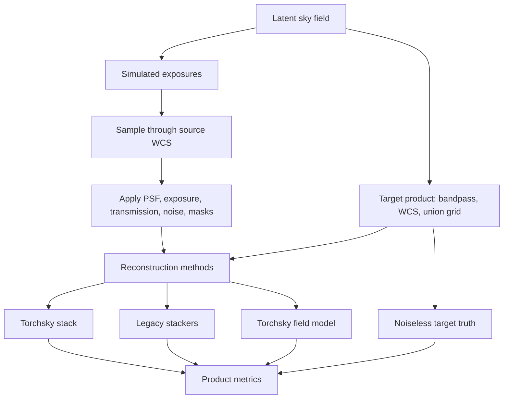

# `torchsky.map`

`torchsky.map` is the promoted mapmaking facade: image-plane coadds, spectral
cube coadds, multiband coadds, and declared map-product specs/results.
Implementation modules such as `torchsky.map.field`, `torchsky.map.product`,
and `torchsky.map.image_plane` remain available for advanced workflows, but the
flat `torchsky.map` namespace is intentionally lean.

## What This Namespace Is For

Use `torchsky.map` when the unit of work is a requested sky product rather than
a single FITS HDU. The core contract is explicit: observations are projected
onto a target product with declared WCS, bandpass, value semantics, masks, and
weights. External tools such as SWarp, Montage, drizzle, and `reproject` are
comparators and parity baselines, not runtime dependencies of the core map path.

Stable promoted surfaces include:
- **Nouns:** `Observation`, `Target`, `CubeTarget`, `ResampleConfig`, `SkyConfig`, `OutlierConfig`, `StackConfig`, `MapResult`, `CubeResult`, `MultibandResult`, `HealpixResult`, `ApertureUncertainty`, `ProductSpec`, `BandpassSpec`, `ProductResult`
- **Verbs:** `plan`, `plan_cube`, `resample`, `resample_healpix`, `blot`, `detect_outliers`, `match_sky`, `coadd`, `coadd_multiband`, `coadd_cube`, `coadd_healpix`, `aperture_uncertainty`, `stack_product`, `evaluate_product`

Field/INR modelling is exposed through the shorter `torchsky.field` namespace;
the implementation still lives under `torchsky.map.field`.

## Core Concepts

- **Observation:** `Observation` describes one calibrated input image (or path) plus
  optional weight/variance maps (`weight`, `var_poisson`, `var_rnoise`, `var_flat`),
  DQ mask (`mask`, `good_bits`), photometric scale, background offset, IFU
  `wavelength_map` / `ifu_wcs`, DCR parameters, or moving-target `tracking_rate`.
- **Noise evidence:** `weight` always controls the coadd denominator. It is
  treated as detector inverse variance only when
  `weight_is_inverse_variance=True`; `weight_path` is explicit inverse variance.
  Default/support/mask-only weights produce no `IVAR` or uncertainty object.
- **Target & Product:** `Target` / `CubeTarget` / `ProductSpec` describe the
  final requested grid and bands.
- **Value semantics:** `surface_brightness` and `flux` products use different
  area-scaling rules. Pick the semantics before comparing against legacy stacks.
- **Resampling kernel:** kernels are explicit (`bilinear`, `lanczos3`,
  `point`, `square`, `exact`, `exact_spherical`, etc.) and have different support,
  interpolation, and flux behavior.
- **Truth evaluation:** methods are compared after producing the same final
  target-grid product, not by inspecting internal warps.

## Recipes

### Coadd Images Onto A Shared Grid

```python
from torchsky.map import Observation, ResampleConfig, StackConfig, coadd, plan

obs = [
    Observation("img_a.fits", weight=1.0, weight_is_inverse_variance=True),
    Observation("img_b.fits", weight_path="img_b_wht.fits"),
]
target = plan(obs, projection="TAN")
result = coadd(
    obs,
    target,
    resample=ResampleConfig(kernel="bilinear", semantics="surface_brightness"),
    stack=StackConfig(method="weighted", tile_size=1024),
)
```

The CLI makes the same distinction: omitting `--weights` uses unit relative
coadd weights, while an explicit `--weights 1.0` is recorded in plan v2 as
inverse-variance evidence. Exact median and iterative sigma-clipped stacks use
capacity-checked scratch storage; set `--scratch-dir` to control its location.
Overlap background rectification also uses capacity-checked scratch storage.
Each exposure is projected once, pairwise difference models feed one globally
anchored weighted graph, and its right-hand side is solved in output tiles;
scratch growth is linear in exposure count rather than in overlap-edge count.
The built-in robust polynomial and mesh estimators keep only compact fit state
and render each correction tile on demand. A custom estimator without compact
tile rendering is rejected in this bounded path instead of allocating a full
output-sized model plane.
When noise is explicit, direct copy, Drizzle, nearest/bilinear/bicubic,
Lanczos/cubic, conservative polygon, and point/box splat paths propagate
diagonal variance with squared geometric coefficients. FFT/spectral remappers
currently return absent uncertainty rather than a diagonal proxy. Distorted-WCS
flux quadrature aggregates repeated source-pixel coefficients before squaring,
so subpixel samples do not incorrectly become independent measurements.
When an exact squared-coefficient plane is available, the uncertainty product
also carries a local inverse-equivalent-noise-bandwidth factor. Request `NCORR`
from the CLI to write it: multiplying the summed diagonal variance of a large,
locally shift-invariant aperture by this factor accounts for interpolation
covariance (identity is 1; a one-axis half-pixel linear shift is 2). The factor
is recorded as `LOCAL_ENBW`/`W1/W2`; on distorted WCS boundaries or small
apertures it is a local kernel diagnostic, not a substitute for full covariance.

For an exact finite-aperture detector-noise result, evaluate the aperture with
the same observation operator and completed weighted-mean map:

```python
aperture = torch.zeros_like(result.data)
aperture[100:110, 120:130] = 1.0
noise = torchsky.map.aperture_uncertainty(
    obs,
    result,
    aperture,
    resample=ResampleConfig(kernel="square", pixfrac=0.8),
    spatial_tile_hw=(512, 512),
)
print(noise.variance, noise.diagonal_variance, noise.correlation_factor)
```

This uses the adjoint of the finite-support reprojection, accumulates reused
source-pixel coefficients across tiles before squaring, and therefore includes
the covariance of the requested aperture without materializing a map covariance
matrix. Aperture weights may be signed. It requires explicit detector inverse
variance and matching execution provenance, and fails closed for median/clipped
products, data-dependent background fits, unsupported pixels, and FFT/spectral
remappers. Detector images are held one at a time and projection intermediates
are tile-bounded.

Schema-v2 plans validate resolved input identities and auxiliary-map identity
pairs, positive finite calibration/weight settings, target shape/header
agreement, closed workflow/kernel/stack/background choices, requested product
planes, runtime device/dtype/seeds, and field spectral metadata before replay.
Replay still recomputes input identities and permits only output and scratch
location overrides.

Deterministic field products likewise return no uncertainty rather than a unit
proxy. Models with an explicit observation-likelihood variance emit a
`model_predictive` product whose component is labelled `detector`.
`render_field_ensemble_product(...)` renders seeded members sequentially and
uses the unbiased between-member sample variance for the `epistemic` component;
optional independently seeded calibration draws add a separate `calibration`
component. Mixed ensembles in which only some members provide detector
uncertainty fail closed. This is a diagonal product, not a covariance model.

Foam, Foam-initialized fields, and the experimental diffuse/Foam hybrid use
structured JSON constructors plus tensor-only state in field artifacts; sites,
radii, coefficients, optimizer moments, RNG state, and topology-adaptation EMAs
never enter JSON or a pickled model object. The hybrid's supported scientific
output is the combined sky. Its component views are diagnostics until injection
tests establish identifiability.

### Plan A Product Once, Stack Many Times

```python
from torchsky.map import BandpassSpec, Observation, ProductSpec, stack_product

observations = [Observation("g_1.fits"), Observation("g_2.fits")]
product = ProductSpec(
    target_header=target_header,
    bands=(BandpassSpec(label="g"),),
    value_semantics="surface_brightness",
)
stacked = stack_product(observations, product, resampling_kernel="bilinear")
```

### Assemble A Spectral Cube (Pre-Rectified or 2D IFU Slices)

```python
import torch
from torchsky.map import Observation, ResampleConfig, coadd_cube
from torchsky.spectral import SpectralAxis

wavelengths = torch.tensor([4800.0, 6500.0], dtype=torch.float64)
edges = torch.tensor([4700.0, 4900.0, 6600.0], dtype=torch.float64)

cube = coadd_cube(
    observations,
    spectral_axis=SpectralAxis(values=wavelengths, unit="Angstrom", type="WAVE"),
    spectral_bin_edges=edges,
    resample=ResampleConfig(spectral_kernel="drizzle"),
)
```

### Compare A Stack To Truth

```python
from torchsky.map import evaluate_product

metrics = evaluate_product(
    prediction=stacked.data,
    truth=truth_image,
    header=stacked.header,
    value_semantics="surface_brightness",
)
print(metrics["reconstruction_rmse"])
```

## API Surface

Promoted flat `torchsky.map` names:

- `Observation`, `Target`, `CubeTarget`
- `ResampleConfig`, `SkyConfig`, `OutlierConfig`, `StackConfig`
- `plan(...)`, `plan_cube(...)`, `plan_product(...)`
- `resample(...)`, `resample_healpix(...)`, `blot(...)`
- `detect_outliers(...)`, `match_sky(...)`
- `coadd(...)`, `coadd_multiband(...)`, `coadd_cube(...)`, `coadd_healpix(...)`
- `aperture_uncertainty(...)`
- `stack_product(...)`, `evaluate_product(...)`
- `MapResult`, `CubeResult`, `MultibandResult`, `HealpixResult`, `ApertureUncertainty`
- `ProductSpec`, `BandpassSpec`, `ProductResult`, `UncertaintyProduct`

Legacy names (`coadd_image_plane`, `coadd_image_plane_cube`, `coadd_image_plane_multiband`, `evaluate_image_plane_aperture_uncertainty`, `MapProductSpec`, etc.) remain supported as compatibility aliases.

Advanced planning, evaluation, and implementation helpers live in explicit
submodules such as `torchsky.map.image_plane`, `torchsky.map.product`,
`torchsky.map.operators`, and `torchsky.map.field`.

Experimental continuous-field layer (tutorial: [field.md](field.md), losses/context:
[implicit_forward.md](implicit_forward.md)):

- `torchsky.field.Observation`, `torchsky.field.Domain`, `torchsky.field.fit(...)`
- `ObservationOperatorBundle` as the shared observation-law substrate across
  image-plane and field paths.
- `torchsky.field.render(...)`, `torchsky.field.sample(...)`
- SIREN/WIRE, Fourier, spectral-basis, sky-encoder, hash-grid, and
  operator-constrained field models.
- `ConstrainedKernelPSF`, `AffineRadiometry`, `SubPixelShift`, and
  `LearnedInstrumentOperator` for constrained learned instrument effects.

## Resampling And Value Semantics

| Kernel family | Typical external analogue | Notes |
|---|---|---|
| `nearest`, `bilinear` | Nearest and linear regridding | Main compatibility baseline. |
| `bicubic`, `catmull_rom`, `mitchell_netravali` | Cubic families | Polynomial definitions differ across tools. |
| `lanczos3`, `lanczos5` | Lanczos mosaickers | Wider support, higher cost. |
| `fft_shift`, `fft_diagonal_affine`, `fft_linear_affine`, `periodic_linear_affine` | Restricted FFT/affine remappers | Same-shape linear-frame tools with explicit boundary semantics. |
| `drizzle_point`, `drizzle_square` | Drizzle drop kernels | Native torchsky implementations. |
| `conservative_polygon` | Conservative overlap | Native overlap remapper. |
| `splat_point`, `splat_box` | Forward deposition | Approximate differentiable splats. |
| `splat_bilinear` (`splat_to_native`) | Adjoint of bilinear `grid_sample` | Flux-conserving deposit onto a native grid. |

Mismatch with SWarp/Montage-style products usually traces to value semantics,
pixel-area treatment, mask policy, or weight maps rather than FITS I/O.

## Truth Evaluation Flow



Metrics include RMSE, MAE, p95/max error, flux error, SNR, coverage, and
zero-support diagnostics.

## Examples

- [HEALPix inverse solve](../examples/example_map_healpix_inverse.py)
- [Harmonic inverse solve](../examples/example_map_harmonic_inverse.py)
- [Shared-vs-survey-private harmonic decomposition](../examples/example_map_harmonic_survey_split.py)
- [Field survey split](../examples/example_map_field_survey_split.py)
- [Spin harmonic inverse solve](../examples/example_map_spin_harmonic_inverse.py)

See [examples.md](examples.md#map) for the full map example index.

## Compatibility And Validation

Key tests:

- `tests/test_map_image_plane.py`
- `tests/test_map_product.py`
- `tests/test_map_ground_truth.py`
- `tests/test_map_multifield_truth.py`
- `tests/test_map_compat_bench.py`

Key benchmarks:

- `benchmarks/bench_map_image_plane.py`
- `benchmarks/bench_map_ground_truth.py`
- `benchmarks/bench_map_multifield_truth.py`
- `benchmarks/bench_map_field_fit.py`
- `benchmarks/bench_map_compat.py`
- `benchmarks/bench_map_smacs0723_*`

See [benchmarks.md](benchmarks.md) for command lines, comparator environments,
SMACS/UPdec real-data runs, and baseline policy.
